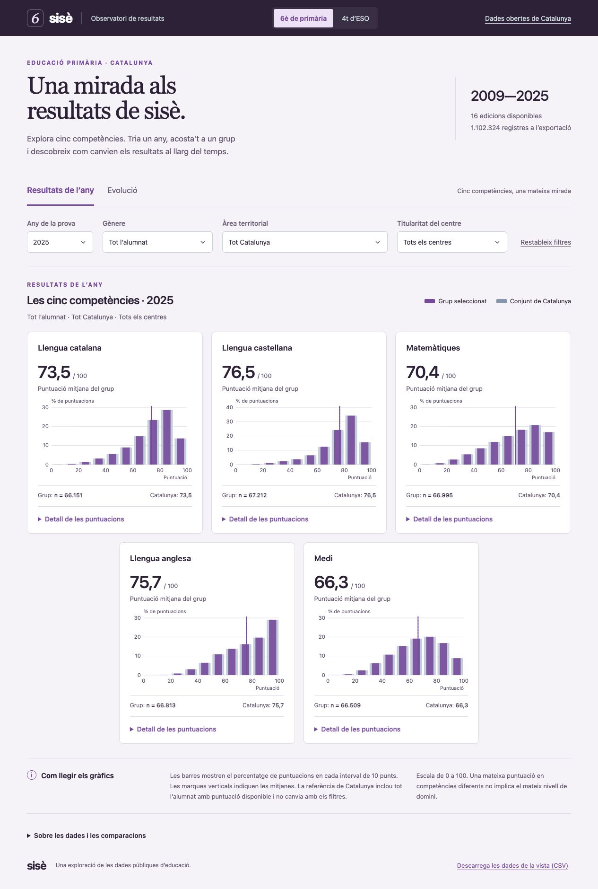

# Avaluacions

An interactive explorer that makes Catalonia’s public school-assessment results easier to understand. It covers **6th-grade primary school** and **4th-year compulsory secondary education (ESO)**, with a Catalan interface.

[Documentació en català](README.ca.md)



## The problem

The source exports contain more than two million assessment records across multiple years, inconsistent category labels, and gaps in subject coverage. A usable public dashboard needs to explain what those scores represent and make comparisons without silently changing the population being compared.

Avaluacions lets visitors select a year, combine demographic and school filters, explore score distributions, and compare results over time. The Catalonia-wide reference stays fixed within each stage and year. Written summaries are calculated from the same values as the charts.

## What it does

- Separate primary and ESO datasets, with a clear stage switch and distinct palettes.
- Filters for gender, education administration area, and public/private school category.
- Annual score distributions, historical trends, and two-year comparisons.
- Expandable component scores with valid-score counts and explicit missing-data states.
- Contextual comparisons between genders and school categories that preserve the other filters.
- CSV exports of the current view.

## Run locally

Python 3 is enough to serve the application. No dependency installation or build step is required.

```sh
python3 -m http.server 8000 --directory docs --bind 127.0.0.1
```

Open [localhost:8000](http://localhost:8000). Serve over HTTP rather than opening the HTML file directly, because the browser loads the aggregate JSON files.

## Architecture and decisions

```text
Source CSV exports → Python aggregation → aggregate JSON → browser calculations → charts and summaries
```

| Decision | Reason | Tradeoff |
|---|---|---|
| Static HTML, CSS and JavaScript modules | Low operating cost, portable hosting, minimal setup | Data updates require regenerating and deploying a snapshot |
| Aggregate before distribution | Keep the browser download small and avoid distributing pupil identifiers or birth dates | New filter dimensions require changing the ingestion step |
| Pure calculation module, separate from presentation | Test numerical behavior independently of the DOM | Presentation behavior still needs browser checks |
| One fixed reference for each stage and year | Prevent filters from silently redefining the comparison baseline | The reference includes the selected group; it is not a matched control |
| Compute summary text from data | Keep explanations consistent with the charts without a runtime AI service | Text describes changes; it cannot explain their causes |
| Use published global scores separately from components | Avoid inventing component weights | The global score cannot be reproduced by averaging the displayed components |

The application has no backend, database, authentication dependency, analytics service, or runtime AI API. The GitHub-ready copy runs independently of the original Sites host.

## Data and interpretation

Source: Generalitat de Catalunya, Dades obertes de Catalunya. Snapshot: **19 November 2026**.

| Dataset | Source records | Coverage |
|---|---:|---|
| [6è de primària](https://analisi.transparenciacatalunya.cat/Educaci-/Avaluaci-de-sis-d-educaci-prim-ria/rk5x-gny6/about_data) | 1,102,324 | 2009–2025, excluding 2020 |
| [4t d’ESO](https://analisi.transparenciacatalunya.cat/Educaci-/Avaluaci-de-quart-d-Educaci-Secund-ria-Obligat-ria/59vm-wwq7/about_data) | 929,604 | 2012–2025, including 2020 |

These are records, not a count of distinct pupils across years. Refer to the original datasets for reuse terms. This is an independent project, not an official government website.

Important boundaries:

- Missing scores are excluded rather than converted to zero. Each result reports its own valid-score count.
- Means weight each valid record equally, using its published score. They may differ from official report populations or processing rules.
- The data does not establish equivalent assessment difficulty across years or stages. Comparisons are descriptive; they do not establish causes or statistical significance.
- Cohorts differ by year. Switching stages does not follow the same pupils through school.
- Territorial labels change over time and are retained without assuming equivalence. Component and subject availability also varies.
- JSON files contain only aggregate dimensions, counts, sums and histograms. Original CSV files, pupil codes and birth dates are excluded from this repository.
- The snapshot is not refreshed automatically. Small aggregate groups are not subject to a disclosure-suppression policy; assess that separately before extending the data or filter dimensions.

Detailed coverage, normalization rules and update instructions are in [README.ca.md](README.ca.md).

## Quality checks

Requires Node.js 22+ and Python 3. The tests use their standard libraries, with no test dependencies.

```sh
node --test tests/model.test.mjs
python3 -m unittest discover -s tests -p 'test_*.py' -v
node --check docs/app.mjs
```

The suite covers both datasets: independently checked reference values, aggregation across gender partitions, weighted means, missing-data semantics, component coverage, filter isolation, signed changes, trend discontinuities, and the aggregate data schema. Hand-calculated CSV fixtures cover decimal commas, normalization, invalid values, zero scores, histogram boundaries, and exclusion of identifiers.

[GitHub Actions](.github/workflows/checks.yml) runs these checks on pushes and pull requests. The workflow has read-only repository permissions. It has not run remotely until the project is uploaded and Actions executes it.

The ingestion script was also run against both complete source exports and reproduced the bundled datasets exactly. Browser checks have been performed during development; they are not automated in this suite. Automated browser regression tests and an accessibility audit remain useful follow-ups.

## When the official datasets add a new year

For example, when 2026 results become available, download fresh CSV exports from the same official dataset links and run `scripts/build_data.py` with those files and the new export date (see below). You can update either stage independently. Review any changed column names, categories or territorial definitions; update the coverage notes and record counts in the documentation and the stage descriptions in `docs/app.mjs` and `docs/index.html`. Run the tests, check the new year in both annual and evolution views (including component scores), then commit the regenerated JSON and related changes and publish them. The year selectors and chart ranges are derived from the generated data, so they will include the new year automatically. The website does not fetch official updates by itself.

## Updating the snapshot

Keep source exports outside the repository or under the ignored `raw-data/` directory.

```sh
python3 scripts/build_data.py \
  --primary raw-data/primaria.csv \
  --eso raw-data/eso.csv \
  --export-date 2026-11-19
```

Review schema and coverage changes, regenerate the data, run the checks, and inspect representative views. Subject labels and coverage notes in the UI currently require manual review when a new export changes the available years or columns.

## Publish

Upload to a repository named **avaluacions**. In **Settings → Pages**, select **Deploy from a branch**, **main**, **/docs**. The application uses relative paths and supports project URLs such as `https://USERNAME.github.io/avaluacions/`.

See [GitHub’s publishing-source documentation](https://docs.github.com/en/pages/getting-started-with-github-pages/configuring-a-publishing-source-for-your-github-pages-site). Any static host can also serve `docs/`.

## Project map

```text
docs/                   Deployable website and aggregate datasets
scripts/build_data.py   Reproducible CSV-to-JSON aggregation
tests/                  JavaScript model tests and Python ingestion tests
.github/workflows/      Automated checks
README.ca.md            Detailed Catalan setup and data documentation
```

## Development context

This is a personal project developed iteratively with AI assistance, starting from questions about public education data and refining the interface through feedback. The emphasis is on turning ambiguous questions into a focused product, validating data semantics, and keeping deployment and maintenance simple.
